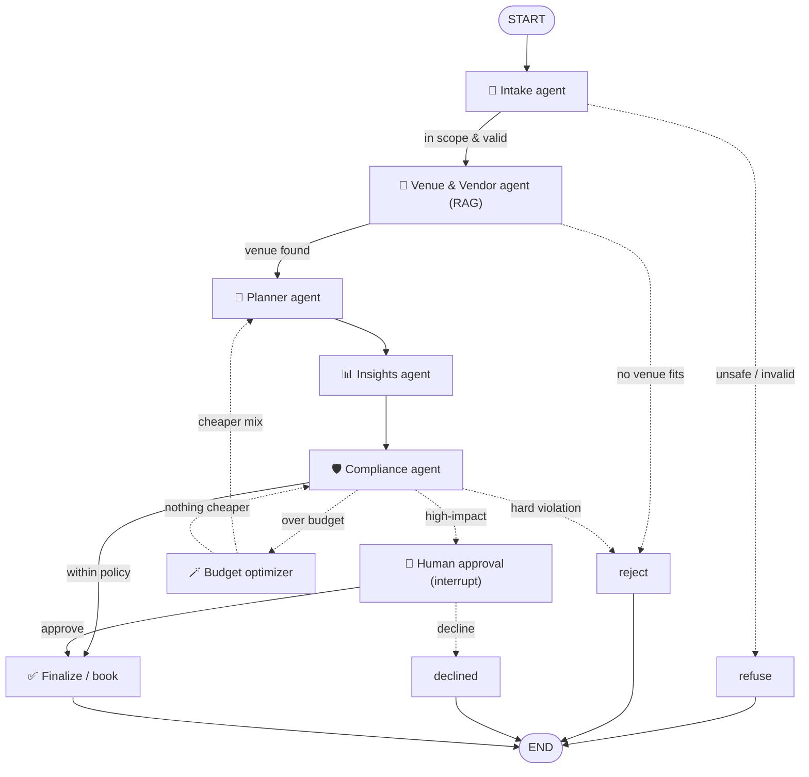

# 🎉 Gatherly — AI Event Planning, Run by a Team of Agents

> Describe your event in one sentence. Six LangGraph agents turn it into a costed,
> weather-checked, policy-approved plan, fix it themselves if it's over budget,
> and hand you a countdown checklist you can drop straight into your calendar.

A working multi-agent AI product that turns a plain-language event request
(*"plan a 150-guest wedding in Bangalore for ₹8 lakh on Dec 18, outdoor"*) into a
**costed, policy-checked event plan that a human approves before anything is booked.**

Built for the *Multi-Agent Orchestration* capstone. It is **not a chatbot** — it is
a team of six specialized agents wired together with **LangGraph**, with shared
state, real tools, RAG grounding, conditional routing, a self-healing budget loop,
guardrails, human-in-the-loop approval, observability, and an evaluation suite.

## ✨ What's new in Gatherly 2.0

| Feature | What it does | Where |
|---|---|---|
| 🪄 **Self-healing Budget Optimizer** | Over budget? Instead of giving up, a new agent swaps in cheaper vendors that still fit (capacity, date, diet) or drops extras you didn't ask for, then loops the plan back through planner → insights → compliance. | `src/agents/optimizer.py` |
| 🌦️ **Weather risk** | Seasonal climatology per city: an outdoor Mumbai wedding in July gets flagged and sent to a human. | `src/tools/weather.py` |
| 🗓️ **Date intelligence** | Understands "Dec 18", "18/12/2026", "next Saturday", "in 3 weeks"; refuses dates in the past. | `src/tools/dates.py` |
| ✅ **Countdown checklist** | Dated T-minus tasks built from the vendors you actually booked; overdue ones are marked urgent. | `src/tools/checklist.py` |
| 📦 **Lean / Balanced / Luxe packages** | The same event priced three ways from the real catalog, so you can compare at a glance. | `src/tools/packages.py` |
| 💯 **Plan health score** | 0-100 with a grade and an explained breakdown: budget headroom, capacity fit, weather, lead time, preferences. | `src/scoring.py` |
| 📤 **Calendar + Markdown export** | `.ics` with the event and every checklist deadline, plus a shareable Markdown plan. CLI saves both automatically. | `src/exporters.py` |

The vendor catalog also grew from 16 to 28 entries (Delhi caterers, budget
alternatives, a rooftop in Mumbai), so the optimizer and packages have real
choices to work with.

---

## 🛡️ Production-ready API (Gatherly 2.1)

| Area | What you get | Where |
|---|---|---|
| 💾 **Durable approvals** | Plans waiting for a human are checkpointed to SQLite, so a server restart no longer loses them. | `src/graph.py` (`make_sqlite_checkpointer`) |
| 🔐 **Admin auth** | Approve/decline, delete and the plan list need `ADMIN_TOKEN` (constant-time check). The web console asks for it once per tab. | `backend/core/security.py`, `frontend/src/components/AdminGate.js` |
| 🚦 **Rate limiting + concurrency cap** | A sliding-window limit per IP on plan creation (`429` + `Retry-After`), a cap on concurrent graph runs, and a timeout per run. | `backend/core/security.py`, `backend/server.py` |
| 🔁 **Idempotency keys** | Send `Idempotency-Key` and a retried POST returns the original plan instead of paying for a second LLM run. | `backend/server.py`, `backend/core/storage.py` |
| 🧯 **LLM resilience** | Retries with exponential backoff and jitter on network, timeout, rate-limit and 5xx errors and on schema mismatches; a bad key fails fast and returns a clean `503`. | `src/llm.py` (`invoke_structured`) |
| 💸 **Token + cost tracking** | Every plan records LLM calls, tokens per agent and estimated USD cost. | `src/usage.py` |
| 🧱 **Prompt-injection guard** | "Ignore previous instructions…"-style requests are refused before any LLM call. | `src/guardrails.py` |
| 🙈 **PII redaction** | Phone numbers, emails and Aadhaar-like numbers are masked before traces are written to disk. | `src/guardrails.py`, `src/logging_utils.py` |
| 📈 **Observability** | `X-Request-ID` on every response, one JSON log line per request, Prometheus `/api/metrics`, and a `/api/ready` readiness probe. | `backend/core/observability.py` |
| 🗄️ **Pluggable storage** | MongoDB in production, with an automatic in-memory fallback so the API runs with zero setup. | `backend/core/storage.py` |
| 🐳 **Docker + CI** | `docker compose up` runs MongoDB, the API and the web app. GitHub Actions runs the tests, a strict web build and both Docker builds. | `docker-compose.yml`, `.github/workflows/ci.yml` |

```bash
# whole stack
export OPENAI_API_KEY=sk-...
export ADMIN_TOKEN=$(python -c "import secrets; print(secrets.token_hex(24))")
docker compose up --build        # web: http://localhost:3000  api: http://localhost:8001

# all tests (no API key, no database needed)
python -m pytest -q
```

## 1. The problem & why it needs multiple agents

Planning an event is not one question — it is a **pipeline of different skills**:
understanding a messy request, researching venues/vendors against a catalog,
costing and scheduling, and checking everything against budget/safety policy
before committing money. A single prompt can fake this but can't do it reliably:
it hallucinates prices, ignores capacity limits, and has no safe "stop and ask a
human" step. We split the job into **six agents with distinct responsibilities**
and a shared state object, so each step is specialized, inspectable, and safe.

## 2. Architecture at a glance



### The six agents

| Agent | File | Responsibility | Output schema |
|-------|------|----------------|---------------|
| 🧾 **Intake** | `src/agents/intake.py` | Parse free text into a structured brief; first safety screen | `EventRequirements` |
| 🔎 **Venue & Vendor** | `src/agents/venue.py` | **RAG** search over the catalog, then select venue + vendors (prices verified from data) | `VendorShortlist` |
| 📅 **Planner** | `src/agents/planner.py` | Build the day timeline + exact budget (via the budget tool) | `EventPlan` |
| 📊 **Insights** | `src/agents/insights.py` | Weather risk, countdown checklist, packages, health score (no LLM) | `Insights` |
| 🛡️ **Compliance** | `src/agents/compliance.py` | Deterministic policy/safety checks; decide auto-approve / escalate / reject / optimize | `ComplianceResult` |
| 🪄 **Budget Optimizer** | `src/agents/optimizer.py` | Greedy vendor swaps to bring an over-budget plan back within budget | `VendorShortlist` |

## 3. Setup (Windows / PowerShell)

> Python 3.12 and `git` are assumed installed. Commands use the `py` launcher.

```powershell
# 1. From the project folder, create and activate a virtual environment
py -m venv .venv
.\.venv\Scripts\Activate.ps1

# 2. Install dependencies
pip install -r requirements.txt

# 3. Add your API key
#    Copy .env.example to .env and paste your OpenAI key into it.
copy .env.example .env
notepad .env        # set OPENAI_API_KEY=sk-...
```

> **macOS / Linux:** `python3 -m venv .venv && source .venv/bin/activate && pip install -r requirements.txt`, then `cp .env.example .env`.

## 4. Run it

> **Windows tip:** if `.\.venv\Scripts\Activate.ps1` is blocked by execution policy,
> skip activation and call the venv's Python directly:
> `.\.venv\Scripts\python.exe -m src.app` (same for `tests.test_cases`).

```powershell
# Interactive — it asks you for an event, then pauses for your approval
python -m src.app

# Or pass the request directly
python -m src.app "Plan a wedding in Bangalore for 150 guests, budget 8 lakh, on 2026-12-18, outdoor, need photography"

# Run the evaluation suite (8 scenarios, real LLM)
python -m tests.test_cases

# Run the offline tests (no API key needed, ~2 seconds)
pip install pytest
python -m pytest tests/test_offline.py -q
```

Every run also writes a full step-by-step trace to `runs/trace-<id>.jsonl`, and a
booked plan is saved as `runs/plan-<id>.md` + `runs/plan-<id>.ics`.

The web API adds `GET /api/plans/{id}/export.ics` and `GET /api/plans/{id}/export.md`.

## 5. Project structure

```
gatherly/
├── README.md                    # this file
├── requirements.txt
├── .env.example                 # copy to .env and add your key
├── data/knowledge_base/
│   └── vendors.json             # the catalog the RAG agent searches
├── src/
│   ├── app.py                   # CLI entry point
│   ├── runner.py                # run loop + human-approval pause/resume
│   ├── graph.py                 # the LangGraph: nodes, routing, HITL
│   ├── state.py                 # shared graph state
│   ├── schemas.py               # Pydantic handoff contracts
│   ├── guardrails.py            # deterministic safety/validation
│   ├── config.py / llm.py       # settings + model factory
│   ├── logging_utils.py         # observability
│   ├── formatting.py            # plan rendering
│   ├── scoring.py               # plan health score
│   ├── exporters.py             # .ics + Markdown export
│   ├── agents/                  # the 6 agents
│   └── tools/                   # RAG, budget, availability, weather, dates, checklist, packages
├── tests/test_cases.py          # evaluation harness (8 scenarios, real LLM)
├── tests/test_offline.py        # 27 offline tests (fake LLM)
├── tests/test_api.py            # 14 API tests: auth, rate limits, idempotency, restarts
└── docs/
    ├── ARCHITECTURE.md          # deep dive
    ├── PRESENTATION.md          # 10-minute talk script
    └── INDIVIDUAL_CONTRIBUTION_TEMPLATE.md
```

## 6.. Notes

- **Security:** the API key lives only in `.env`, which is gitignored. Never commit it.
- **Cost:** uses `gpt-4o-mini` + `text-embedding-3-small` — a few US cents per full run.
- **Model is swappable:** change the provider in `src/llm.py` / `.env` to use a
  different LLM later; the rest of the system is unchanged.

See **`docs/ARCHITECTURE.md`** for the deep dive and **`docs/PRESENTATION.md`** for the demo script.
